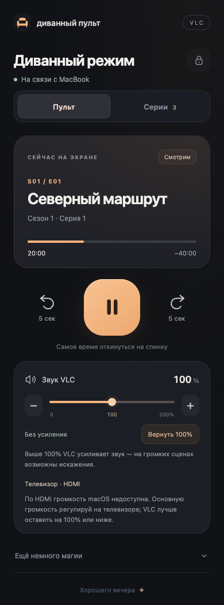
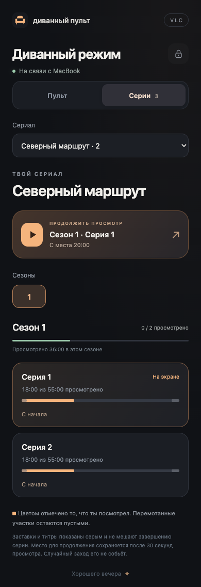

# VLC Series · диванный пульт

Пульт для **VLC 3.x на macOS** в браузере телефона. Mac воспроизводит фильм на телевизоре, а телефон управляет им по домашней сети. На Android и iPhone достаточно браузера; облако и отдельное мобильное приложение не нужны.




## Что умеет

- Пауза и продолжение, перемотка ровно на **−5 / +5 секунд**, следующий эпизод, полный экран.
- Шкала времени **только для просмотра**: касание при прокрутке страницы не перематывает видео.
- Громкость VLC **0–200%**, заметная граница усиления 100%, возврат к 100% одной кнопкой, mute с сохранением уровня.
- Отдельная громкость и mute macOS, когда текущий аудиовыход их поддерживает. Для HDMI показано пояснение: системная громкость часто недоступна, основной уровень задаётся телевизором.
- Выбор аудиодорожки и субтитров.
- **Несколько сериалов**, выбор сезона и серии, продолжение с сохранённого места или запуск сначала.
- Настоящие просмотренные участки: прыжок вперёд не заполняет пропущенный сюжет. Случайный заход на несколько секунд не заменяет основную точку продолжения.
- Автопропуск проверенных заставок и переход на следующую серию на финальных титрах. Оба режима можно отключить; последняя серия не переключает на другой сериал.
- Вход по трём картинкам. Установка генерирует свою комбинацию, браузер запоминает вход на 30 дней.

Пульт запускается **внутри VLC** и закрывается вместе с ним. Трекер продолжает считать прогресс и выполнять переходы, даже когда страница телефона закрыта. Приложение проверено с VLC 3.0.23 на Apple Silicon; Windows, Linux и VLC 4 пока не поддерживаются как хост пульта.

## Быстрый старт

Нужны VLC 3.x, Python 3.10+, Apple Command Line Tools для сборки помощника громкости и FFmpeg для анализа файлов. Например, при установленном Homebrew:

```sh
brew install python ffmpeg
xcode-select --install  # только если Command Line Tools ещё нет

git clone https://github.com/Waksim/vlc-series.git
cd vlc-series
```

Полностью выйдите из VLC **перед первой установкой**:

```sh
python3 sofa.py install
python3 sofa.py add "/путь/к/Сериалу" --title "Название сериала"
open -a VLC
python3 sofa.py doctor --check-auth
python3 sofa.py access
```

`doctor` покажет адреса вида `http://<IP-Mac>:8080/` и проверит работающий API. `access` покажет комбинацию картинок. Откройте адрес с телефона в той же сети. В разделе **«Серии»** выберите сериал, сезон и эпизод. Для первого запуска не обязательно заранее открывать видео на Mac.

Если VLC ещё не создавал свой профиль, установщик создаст нужные настройки. Существующий пароль, сеансы и история сохраняются. Другую настроенную Lua-интеграцию установщик не перезаписывает.

## Добавить сериалы

```sh
# Проверить названия и длительности без изменения каталога
python3 sofa.py scan "/путь/к/Сериалу" --durations

# Один сериал
python3 sofa.py add "/путь/к/Сериалу" --title "Название"

# Коллекция: каждая дочерняя папка — отдельный сериал
python3 sofa.py add "/путь/к/Коллекции" --collection

python3 sofa.py list
```

Поддерживаются `S02E03`, `S02.E03`, `2x03`, а внутри папок `Season 02`, `Сезон 2` или `S02` — `Episode 03`, `E03`, `Серия 03`, `03 - Название`. Индексация идёт до трёх вложенных папок. Дубликаты номеров требуют исправления; пульт не выбирает один релиз молча. Нераспознанные файлы перечисляются в отчёте.

У сериала постоянный ID, не связанный с названием. Повторный `add` для того же пути обновляет длительности, не сбрасывая историю. Существующие файлы сканируются пультом раз в 30 секунд; для новых файлов запустите `add` снова, чтобы заранее заполнить длительности. Удалённые серии не отображаются, их история остаётся сохранённой.

**Добавление сериала и изменение `markers.json` подхватываются без перезапуска.** Выбор другого сериала в каталоге не меняет то, что сейчас воспроизводится: запуск происходит только по нажатию на серию.

## Скилл для агента

Русский скилл [`vlc-series`](skills/vlc-series/SKILL.md) выполняет работу в два этапа:

1. Проверяет файлы, добавляет сериалы, проверяет пульт и **сразу сообщает ссылку**, чтобы можно было начать просмотр.
2. Затем извлекает кадры из каждой серии, проверяет границы и записывает манифесты заставок и титров.

Для Codex:

```sh
python3 tools/install_skill.py
```

В новом чате:

```text
$vlc-series Добавь сериалы из /путь/к/Коллекции.
Сначала подготовь каталог и дай ссылку на пульт, потом разметь заставки и титры.
Не прерывай текущий просмотр.
```

Скилл **вызывается явно**: `allow_implicit_invocation: false`. Его короткое описание остаётся доступным для обнаружения, основной текст и правила разметки не подмешиваются в обычные задачи. Скрипт скилла находит установленный репозиторий; при нестандартной установке задайте `SOFA_REMOTE_REPO=/путь/к/vlc-series`.

Другие агенты могут прочитать этот же `SKILL.md` вручную. Для доработок есть [`AGENTS.md`](AGENTS.md), [описание архитектуры и API](docs/architecture.md) и тесты.

## Заставки и титры

Разметка хранится в **`markers.json` прямо рядом с сезонами**. Видео не изменяются. Для подготовки кадров:

```sh
python3 -m venv .venv
.venv/bin/pip install -r requirements-frames.txt
.venv/bin/python sofa.py frames <ID> s01e01 --times 0:180:15 --output work/opening.jpg
python3 sofa.py markers init <ID>
```

Времена подтверждаются по соседним кадрам **каждой серии**; одинаковая длительность заставки не гарантируется. До сюжета остаётся около 3 секунд заставки, переход на следующую серию — примерно через 2 секунды финальных титров. Сцены до заставки, между титрами и после них сохраняются. Без уверенной разметки соответствующий переход отключён.

[Правила, команды и формат манифеста](skills/vlc-series/references/markers.md).

## Как считается прогресс

Пульт объединяет действительно просмотренные интервалы, не засчитывая перемотки и повторный просмотр дважды. Точка **«Продолжить»** обновляется после 30 секунд реального просмотра в текущем заходе. Три случайные секунды будут видны на шкале, но не заменят прежнюю закладку. При просмотре 95% сюжетной части серия считается завершённой; проверенные заставки и титры исключаются из расчёта.

История независима для одинаковых номеров серий в разных сериалах. Обновление старой версии с одним сериалом сохраняет прежние ключи истории.

## Обновления и данные

```sh
git pull
python3 sofa.py install         # VLC закрыт
# либо во время просмотра, если пульт уже настроен:
python3 sofa.py install --stage
```

`--stage` сохраняет новый код без остановки VLC и без изменения его текущих настроек. Lua-код включится после следующего полного выхода и запуска. В Sofa Remote 1.x обновления HTML/CSS/JS подхватываются после обновления страницы; каталог и манифесты — автоматически.

Приватные данные находятся в:

```text
~/Library/Application Support/org.videolan.vlc/sofa-remote/
```

`settings.json` содержит пароль и порт; `libraries.json` — пути сериалов; `progress.json` и `.bak` — историю; `playback.json` — переключатели автоматики. Эти файлы, фильмы, кадры, журналы и собранный бинарник **не входят в Git**. Не публикуйте свою установленную папку вместо исходников.

Для отключения полностью выйдите из VLC и удалите только `luaintf{intf=sofa}` и `luaintf{intf=sofa_tracker}` из `extraintf` в `~/Library/Preferences/org.videolan.vlc/vlcrc`. Историю можно оставить. Не заменяйте весь файл настроек старой резервной копией, если позднее меняли другие параметры VLC.

## Если телефон не подключается

- Откройте адрес именно с **`http://`**, используя IP из `doctor`. `.local` поддерживается не всеми сочетаниями Android и сети.
- Проверьте, что VLC запущен, а обе машины в одной обычной Wi-Fi-сети, не в гостевой сети с изоляцией клиентов.
- Проверьте доступ к локальной сети в VPN телефона и разрешение входящих соединений для VLC в брандмауэре macOS.
- Ответ с самого Mac подтверждает работу сервера, но не проверяет путь от телефона. Не отключайте целиком защиту сети и не открывайте порт в интернет.

Пульт предназначен для доверенной домашней сети: HTTP без TLS и простой графический пароль не заменяют публичную систему авторизации. Управление громкостью самого телевизора по Wi-Fi/CEC пока не реализовано.

## Проверки

```sh
python3 -m unittest discover -s tests -v
python3 tests/run_lua.py        # Lua 5.1+ или отдельный VLC на Mac
node --check web/app.js
python3 build_audio.py          # macOS
```

Проверка интерфейса на синтетических данных:

```sh
npm ci
npx playwright install chromium
npm run test:ui
# либо SOFA_CHROME=1 npm run test:ui — с установленным Google Chrome
```

Дополнительная интеграционная проверка на Mac с FFmpeg:

```sh
SOFA_TEST_VLC=1 python3 -m unittest discover -s tests -p test_vlc.py -v
```

Она запускает отдельный VLC с синтетическим беззвучным видео, случайным локальным портом и временной историей. Основной процесс не управляется; закрывается только тестовый. CoreAudio-тест подменяет драйверные функции и не меняет системную громкость.

## Лицензия

[MIT](LICENSE). Код пульта и инструменты можно использовать и дорабатывать. VLC и FFmpeg распространяются отдельно под своими лицензиями; фильмы в проект не входят.
